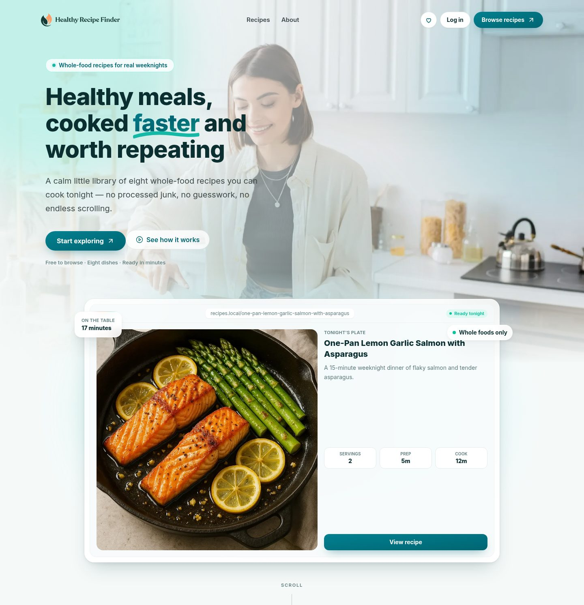
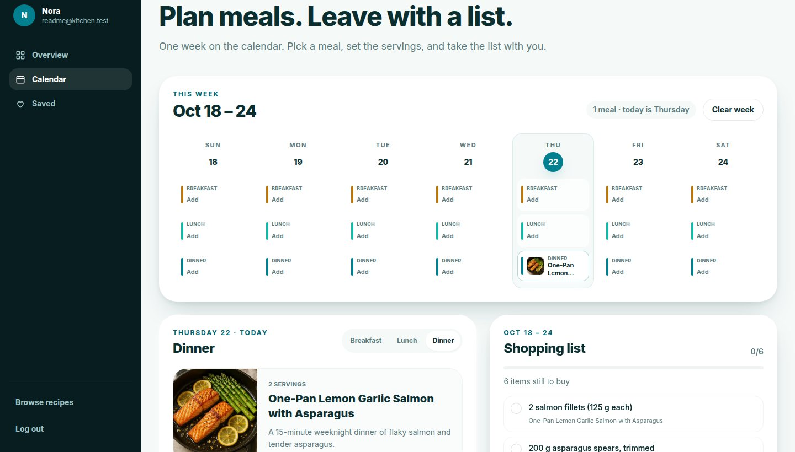
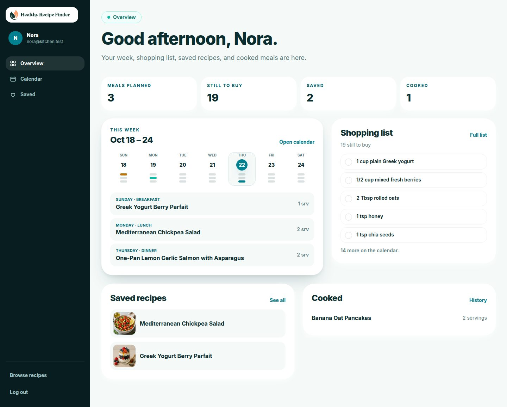

# Healthy Recipe Finder



A React app for finding whole-food recipes, scaling servings, cooking step by step, and planning a week of meals. Recipes live in `data.json`. Favorites, recent views, cooked history, and the weekly plan stay in the browser.

Live site: [https://healthy-recipe-finder-ashy.vercel.app/](https://healthy-recipe-finder-ashy.vercel.app/)

## What you can do

- Search titles, overviews, and ingredients. Every word has to match.
- Limit prep time and cook time, filter by diet, and sort by featured order, total time, prep time, or name.
- Share a filtered list. Search, prep, cook, diet, and sort are stored in the URL (`q`, `prep`, `cook`, `diet`, `sort`).
- Open a recipe, scale servings from 1 to 12, and keep mixed numbers and fractions.
- Start cook mode, step through the instructions, and record that you cooked it.
- Save recipes, see what you opened recently, and review cooked history.
- Plan breakfast, lunch, and dinner for a Sunday-start week. Today follows the `Asia/Hebron` calendar.
- Build one shopping list from the plan. The same ingredient and unit are merged, and checked items stay checked after a reload.

Diet tags (vegetarian, vegan, gluten-free, protein-forward) are read from the ingredient list. They are a kitchen heuristic, not a lab analysis. Difficulty is Easy when the recipe is 15 minutes or less with at most four steps, Weeknight at 30 minutes or less, and Weekend after that.

The week is a Sunday-to-Saturday calendar. Today follows `Asia/Hebron`. Pick a day, set the servings, and the shopping list updates beside it.



After you log in, the kitchen dashboard keeps the week, the shopping list, saved recipes, and cooked meals in one place.



## Routes

| Path | Page |
| --- | --- |
| `/` | Home, with scroll motion |
| `/recipes` | Searchable recipe list |
| `/recipe/:slug` | Recipe detail, servings, cook mode, and add to plan |
| `/login` | Create an account or log in |
| `/dashboard` | Kitchen overview, inside the dashboard sidebar |
| `/plan` | Weekly calendar and shopping list, inside the dashboard |
| `/saved` | Saved recipes, recently viewed, and cooked history, inside the dashboard |
| `/about` | About the project |

Browsing recipes stays open. The dashboard, calendar, and saved page ask you to log in.

## Kitchen data

Accounts stay in this browser. Passwords are stored as a hash, not as plain text. Each account has its own kitchen under `hrf.kitchen.v1:<account>`:

- favorites
- the last eight recipes you opened
- up to forty cooked entries, each with servings and a time
- the week plan, with servings clamped from 1 to 12
- shopping-list checks

Clearing site data for this origin resets the kitchen.

## Scripts

```bash
npm install
npm run dev
npm run build
npm run preview
node --test src/utils/recipeLogic.test.js src/auth/authLogic.test.js
```

The logic tests cover ingredient search, diet tags, sorting, quantity scaling, the merged shopping list, plan slots, and related recipes.

## Stack

React 18, Vite 5, Tailwind CSS 3.4, and React Router 6. The interface uses Inter, a teal canvas, and scroll motion. `prefers-reduced-motion` turns those animations off.

## Project structure

```
data.json                      # The eight recipes
src/
├── App.jsx                    # Routes wrapped in KitchenProvider
├── main.jsx
├── index.css                  # Motion, type, and reduced-motion rules
├── kitchen/
│   └── KitchenContext.jsx     # Favorites, recent, cooked, plan, checks
├── pages/
│   ├── Home.jsx
│   ├── Recipes.jsx
│   ├── RecipeDetail.jsx
│   ├── Planner.jsx
│   ├── Saved.jsx
│   └── About.jsx
├── layout/
│   ├── Header.jsx
│   ├── Navigation.jsx
│   ├── Footer.jsx
│   └── MainLayout.jsx
├── components/
│   ├── RecipeCard.jsx
│   ├── RecipeFilters.jsx
│   ├── RecipeGrid.jsx
│   ├── RecipeInfo.jsx
│   ├── RecipeIngredients.jsx
│   ├── RecipeInstructions.jsx
│   ├── SearchBar.jsx
│   ├── FilterDropdown.jsx
│   ├── ServingsControl.jsx
│   ├── CookMode.jsx
│   ├── AddToPlan.jsx
│   ├── FavoriteButton.jsx
│   ├── marketing/             # Home sections
│   └── ui/                    # Buttons, eyebrow, reveal
├── hooks/
│   ├── useRecipes.js
│   ├── useRecipeFilters.js    # Reads and writes the filter URL
│   ├── useScrollHeader.js
│   ├── useInView.js
│   └── useParallax.js
├── services/
│   └── recipeService.js       # Loads data.json
├── utils/
│   ├── recipeLogic.js         # Search, diet, scale, plan, shopping list
│   └── recipeLogic.test.js
└── constants/
    ├── navigation.js
    └── filterOptions.js
```

Recipe photos and icons live in `public/assets/images/`.
